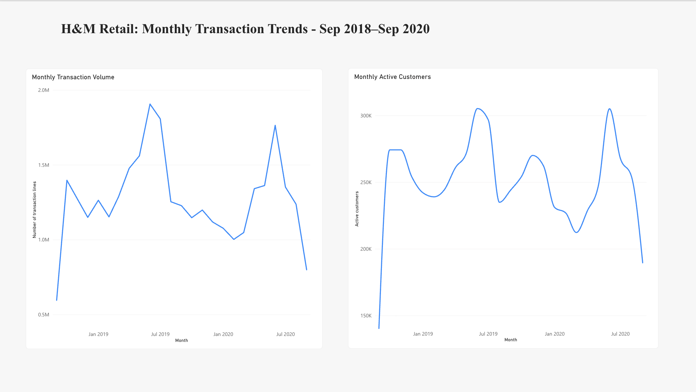

# H&M Retail Analytics & Insights

## Project Overview
Analyzed H&M’s large-scale retail transaction data using MySQL and Power BI to explore purchasing patterns, product mix, and monthly customer activity.

## Dataset
The project uses H&M’s publicly available retail dataset. The transaction table contains 31.8M+ item-level records spanning September 2018 to September 2020.

The full raw dataset is not included in this repository. A small monthly aggregate CSV is provided for reference.

## Analysis
- Monthly item-line volume and distinct active customers using SQL
- Product-category concentration by item-line volume
- Customer purchasing and cohort-retention patterns

## Dashboard
A Power BI report visualizes monthly item-line volume and active-customer activity.

## Tools
- MySQL
- SQL
- Power BI
- GitHub

## Repository Structure
- `sql/` — SQL analysis queries
- `data/` — small aggregate output, not raw transaction data
- `visuals/` — Power BI dashboard screenshot

## Notes and Limitations
- Item-line counts represent records/items, not monetary sales or revenue.
- The dataset’s price field is not treated as verified currency revenue.
- Channel IDs are not labeled as online or physical store without confirming their definitions.
- Monthly active-customer counts are distinct within each month; a customer can appear in multiple months.
- September 2018 and September 2020 are partial months in the dataset.