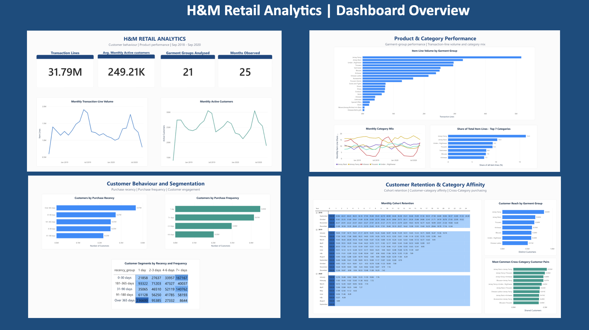

# H&M Retail Analytics: Customer Behaviour, Product Performance & Retention

An end-to-end retail analytics project using **MySQL and Power BI** to analyse transaction trends, garment-group performance, customer purchase behaviour, cohort retention, and cross-category affinity.

## Project Overview

Retail businesses need to understand what customers purchase, which product categories attract the most demand, how frequently customers return, and how purchasing behaviour changes over time.

This project analyses H&M's historical transaction data to answer these questions through SQL-based analysis and an interactive Power BI dashboard. The goal is to translate transaction-level data into findings that can support product assortment planning, customer engagement, retention analysis, and cross-category recommendations.

## Dashboard Preview

The Power BI dashboard contains four pages, each focused on a different aspect of retail performance.



### Dashboard Pages

| Page | Focus | Key Analyses |
|---|---|---|
| Executive Overview | Overall retail activity | Transaction-line volume, monthly active customers, garment groups analysed, months observed |
| Product Performance | Product and category demand | Item-line volume by garment group, monthly category mix, share of total item lines |
| Customer Segments | Purchase behaviour | Purchase recency, purchase frequency, recency-frequency segmentation |
| Retention and Affinity | Customer retention and category overlap | Monthly cohort retention, customer reach by garment group, cross-category customer pairs |

## Key Business Insights

### 1. Product and Category Performance

- **Jersey Fancy is the largest garment group by transaction-line volume**, with approximately 5.2 million item lines and a 16.3% share of total item lines.
- Jersey Basic contributes approximately 10.3% of item lines.
- Under-, Nightwear and Trousers each contribute approximately 9.3%.
- Monthly category shares vary across the observed period, indicating that demand is not distributed uniformly across garment groups.

**Business implication:** The leading categories warrant closer attention during assortment and inventory reviews. Transaction volume alone does not establish profitability, so category-level revenue, margins, discounting, returns, and stock availability should also be considered before allocating additional inventory.

### 2. Customer Behaviour and Segmentation

- Approximately 368,000 customers fall into the over-365-day purchase-recency group.
- Approximately 448,000 customers appear in the one-day purchase-frequency group.
- The recency-frequency matrix shows that customers differ in both how recently they purchased and how many distinct purchase days they have recorded.

**Business implication:** Customers with different purchase histories may respond differently to engagement campaigns. Recency and purchase frequency can help identify audiences for re-engagement and second-purchase experiments. Campaign effectiveness should be evaluated using repeat-purchase rates and incremental customer activity.

### 3. Customer Retention

- The September 2018 cohort has a displayed next-month retention rate of approximately 43.86%.
- Retention varies across acquisition cohorts and subsequent months.
- Newer cohorts have shorter observation windows than older cohorts, so their retention figures should not be compared across unequal follow-up periods.

**Business implication:** Cohort analysis helps reveal when customer engagement declines after the first purchase. Retention initiatives can be evaluated by comparing equivalent cohort periods and measuring whether repeat purchasing improves.

### 4. Customer Reach and Cross-Category Affinity

- Jersey Fancy reaches approximately 0.83 million distinct customers, the highest customer reach among the garment groups displayed.
- Jersey Basic reaches approximately 0.66 million distinct customers.
- Jersey Basic and Jersey Fancy form the largest displayed cross-category customer pair, with approximately 0.53 million shared customers.
- Other frequently shared category pairs include Jersey Fancy with Trousers and Jersey Fancy with Knitwear.

**Business implication:** Category overlap provides a basis for testing complementary product recommendations, coordinated merchandising, and cross-category campaigns. A large shared customer base indicates overlap, but does not by itself establish that recommending one category will cause additional purchases.

## Project Objectives

- Analyse historical transaction activity and monthly changes in item-line volume.
- Identify leading garment groups by transaction-line volume and share of total item lines.
- Examine customer purchase recency and frequency.
- Segment customers using a recency-frequency matrix.
- Measure retention across monthly first-purchase cohorts.
- Compare distinct customer reach across garment groups.
- Identify customer overlap between garment-group pairs.
- Present findings through a structured Power BI dashboard.

## Tools and Technologies

- **MySQL 8.0-compatible SQL:** Data aggregation, joins, customer segmentation, cohort analysis, and category affinity.
- **Power BI:** Dashboard design, KPI cards, trend charts, bar charts, and matrix visualisations.
- **CSV:** Storage and exchange of analytical result sets.
- **GitHub:** Version control and project documentation.

## Dataset

**Source:** [H&M Personalized Fashion Recommendations — Kaggle](https://www.kaggle.com/competitions/h-and-m-personalized-fashion-recommendations/data)

The original dataset contains transaction history and supporting customer and article metadata.

### Source Tables

| Dataset | Description |
|---|---|
| `transactions_train.csv` | Transaction date, customer ID, article ID, price, and sales channel |
| `customers.csv` | Customer attributes, including age, membership status, and communication preferences |
| `articles.csv` | Article metadata, including product type, department, colour, and garment group |

The transaction data covers **20 September 2018 to 22 September 2020** and contains approximately **31.79 million transaction records** in the full dataset.

The analysis uses transaction history alongside customer and article metadata to produce the aggregated results visualised in Power BI.

## Repository Structure

```text
hm-retail-analytics/
│
├── data/
│   ├── category_pair_overlap.csv
│   ├── customer_category_affinity.csv
│   ├── customer_cohort_retention.csv
│   ├── customer_frequency.csv
│   ├── customer_recency.csv
│   ├── customer_recency_frequency.csv
│   ├── monthly_category_trends.csv
│   ├── monthly_trends.csv
│   └── product_category_performance.csv
│
├── sql/
│   ├── category_pair_overlap.sql
│   ├── customer_category_affinity.sql
│   ├── customer_cohort_retention.sql
│   ├── customer_frequency.sql
│   ├── customer_purchase_frequency.sql
│   ├── customer_recency_analysis.sql
│   ├── customer_recency_frequency.sql
│   ├── monthly_category_trends.sql
│   ├── monthly_trends.sql
│   └── product_category_analysis.sql
│
├── visuals/
│   └── [Power BI visual assets, if retained here]
│
├── hm_retail_powerbi_dashboard.png
├── .gitignore
└── README.md
```

The dashboard preview is stored in the repository root. The `visuals/` directory is intended for additional visual assets retained in the repository.

## SQL Analysis

The SQL scripts are organised around the business questions they address.

| SQL Script | Purpose |
|---|---|
| `monthly_trends.sql` | Analyse monthly transaction-line volume and active-customer trends |
| `monthly_category_trends.sql` | Examine changes in category-level transaction-line share over time |
| `product_category_analysis.sql` | Compare transaction-line volume across garment groups |
| `customer_recency_analysis.sql` | Group customers by time since their last observed purchase |
| `customer_frequency.sql` | Analyse customer purchase-frequency patterns |
| `customer_purchase_frequency.sql` | Analyse purchase frequency using the project's defined frequency buckets |
| `customer_recency_frequency.sql` | Combine recency and frequency into customer segments |
| `customer_cohort_retention.sql` | Calculate retention by first-purchase cohort and elapsed month |
| `customer_category_affinity.sql` | Analyse customer reach and purchasing overlap across categories |
| `category_pair_overlap.sql` | Rank garment-group pairs by shared customers |

The CSV files in `data/` contain analytical outputs used to support the dashboard and its findings.

## Methodology

1. **Data preparation:** Use transaction, customer, and article information to prepare the required analytical datasets.
2. **Transaction analysis:** Aggregate transaction-line activity by month and garment group.
3. **Customer analysis:** Derive purchase recency and frequency groups using observed transaction history.
4. **Cohort analysis:** Group customers by their first observed purchase month and measure subsequent purchasing activity.
5. **Category affinity:** Compare distinct customer reach across garment groups and identify category pairs with shared customers.
6. **Visualisation:** Present the resulting metrics through KPI cards, trend charts, horizontal bar charts, and a recency-frequency matrix in Power BI.
7. **Business interpretation:** Translate observed patterns into potential actions while distinguishing descriptive findings from hypotheses that require further testing.

## Metric Definitions

- **Transaction-line volume:** Count of transaction records included in the relevant aggregation; it is not the same as revenue or units sold unless the underlying data and aggregation establish that equivalence.
- **Monthly active customers:** Distinct customers with at least one recorded transaction during a month.
- **Purchase recency:** Time elapsed between a customer's last observed purchase and the analysis reference date.
- **Purchase frequency:** Number of distinct purchase days used by the project's frequency grouping.
- **Cohort retention:** Percentage of customers in a first-purchase cohort who purchase again in a subsequent elapsed month, using the cohort definition implemented in the SQL analysis.
- **Customer reach:** Number of distinct customers associated with a garment group.
- **Cross-category overlap:** Number of customers shared by a pair of garment groups.
- **Category share:** A garment group's transaction-line volume divided by total transaction-line volume for the defined analysis scope.

## Business Applications

The analyses can support:

- **Assortment planning:** Understand which garment groups contribute the largest transaction-line volumes.
- **Customer engagement:** Identify customer segments for targeted communication and re-engagement experiments.
- **Retention management:** Compare customer cohorts to understand how repeat purchasing changes over time.
- **Cross-category recommendations:** Identify commonly shared customer groups for recommendation experiments.
- **Performance monitoring:** Track monthly changes in transaction activity and category mix.

These applications are proposed uses of the analysis. The dashboard describes historical patterns; additional financial data and controlled experiments would be needed to establish commercial impact.

## Scope and Interpretation

This project focuses on descriptive retail analytics using historical data from September 2018 to September 2020. It analyses transaction-line activity, customer behaviour, cohort retention, garment-group reach, and category overlap.

The results describe the observed dataset and should be interpreted within its time period and metric definitions. Transaction volume and customer overlap do not independently measure profitability or prove causation.

## Acknowledgement

The dataset is provided through the [H&M Personalized Fashion Recommendations competition on Kaggle](https://www.kaggle.com/competitions/h-and-m-personalized-fashion-recommendations/data). Use of the source data is subject to the competition's terms and rules.
